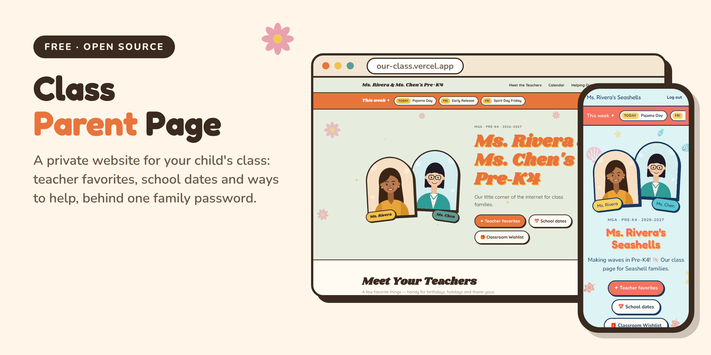
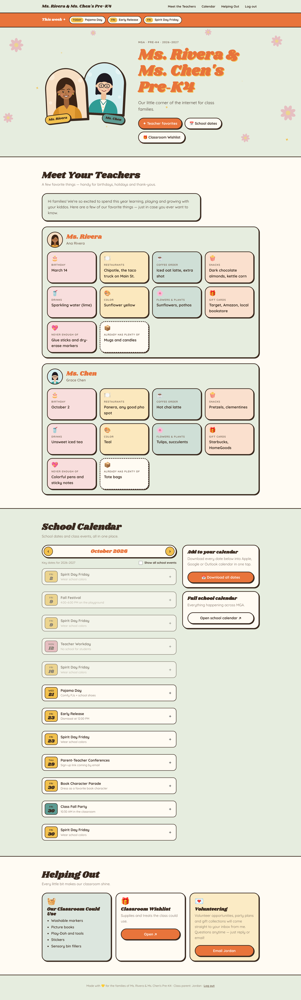
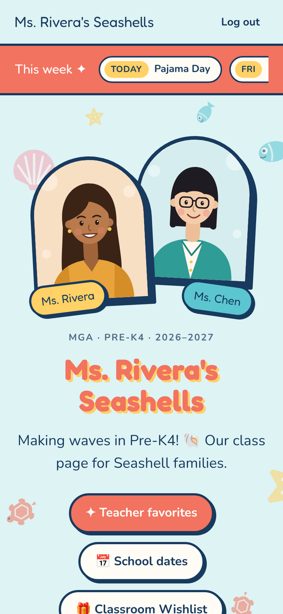
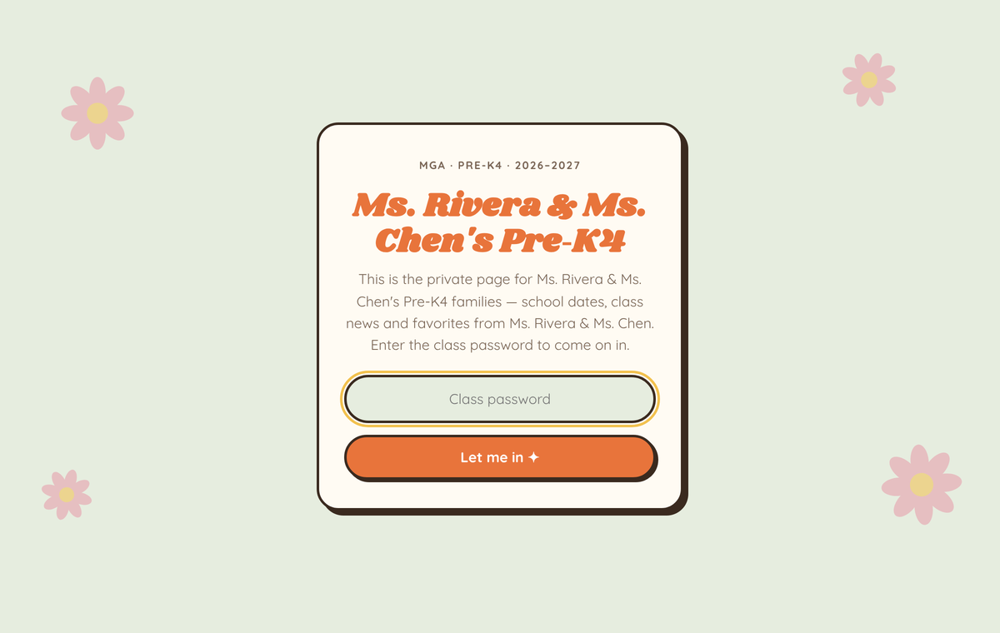
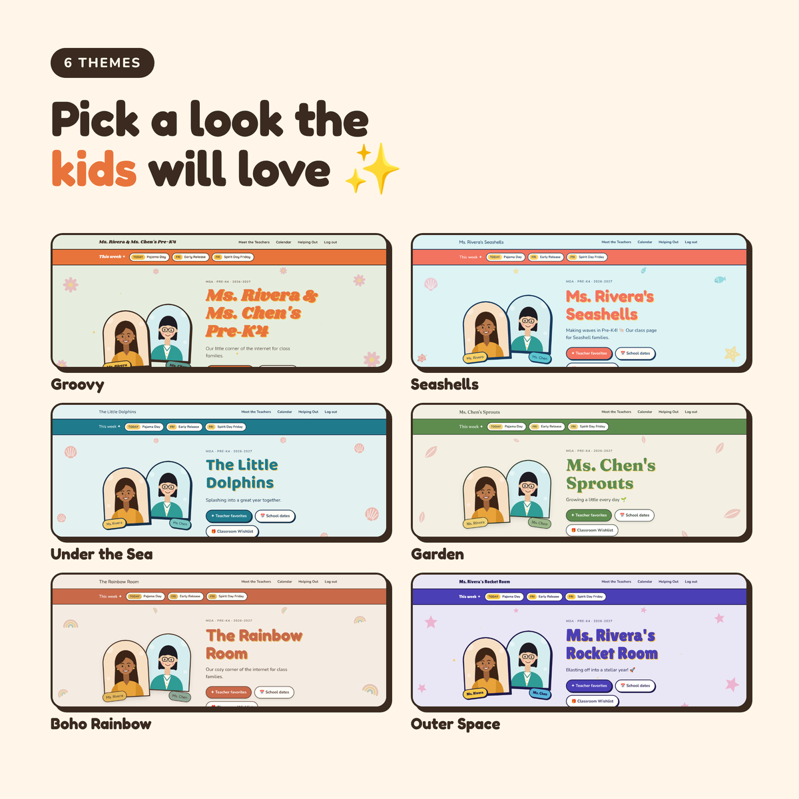
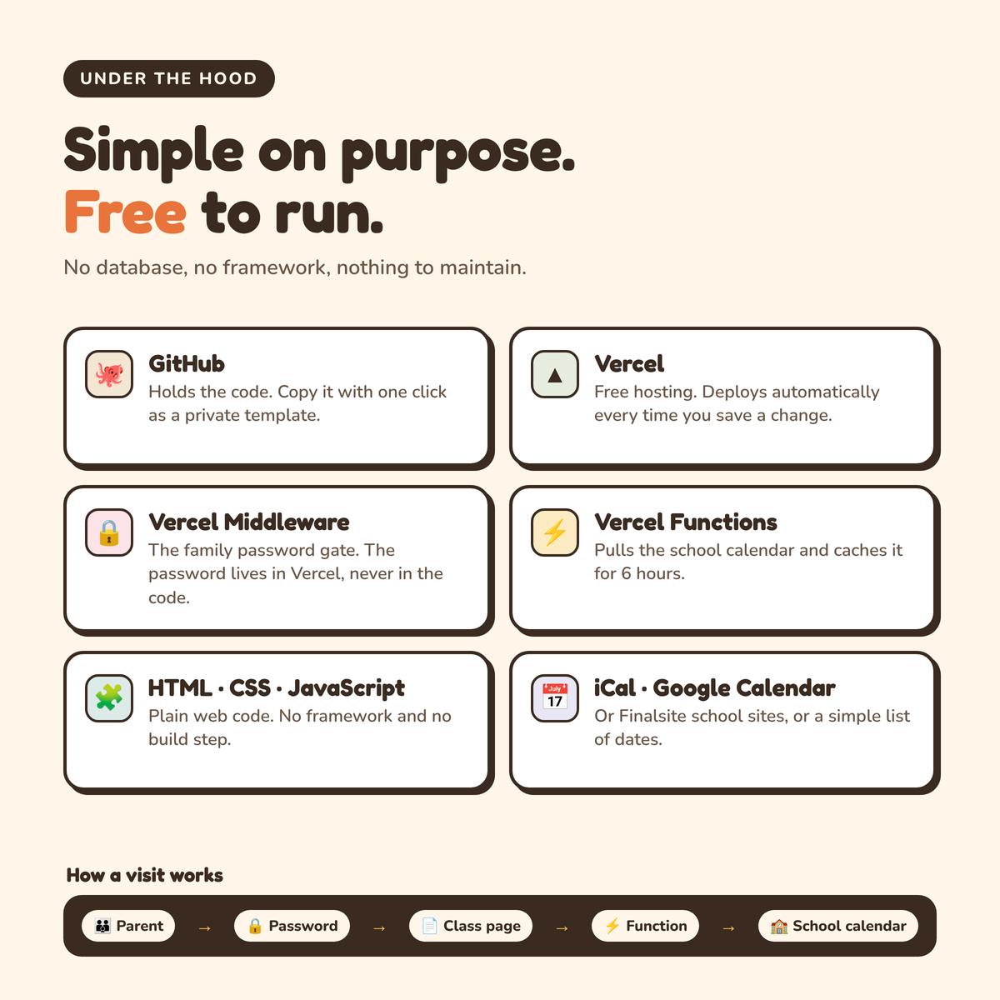

<p align="center"></p>

# Class Parent Page

A free, private website for your child's class. Families get **one link and one password**, and see:

- 🍎 **Teacher favorites**: coffee orders, snacks, gift cards, and what the teacher already has plenty of. No more guessing on gifts.
- 📅 **School calendar**: a "This week" banner plus a month-by-month view. It can pull straight from your school's calendar. One tap adds any date (or all of them) to a phone calendar.
- 🧺 **Helping out**: the classroom wishlist, a Venmo/wishlist link, and an email button for the class parent.
- 🎨 **Six themes**: Groovy, Seashells, Under the Sea, Garden, Boho Rainbow and Outer Space.

Everything lives in **one file, `config.js`**. No coding needed, no database, and it runs free on Vercel.

| Desktop | Phone |
|---|---|
|  | <br><br> |

---

## Set it up (about 15 minutes)

You need a free [GitHub](https://github.com) account and a free [Vercel](https://vercel.com) account (sign in to Vercel with GitHub).

### 1. Make your own copy

Click **Use this template → Create a new repository** at the top of this page.
Choose **Private**. Your copy will hold teacher names and photos, so keep it private.

### 2. Fill in `config.js`

You can do this right on github.com. Open `config.js`, click the ✏️ pencil, edit, then **Commit changes**.

The file comes filled with a made-up demo class (Maple Grove Academy). Replace it with your own:

| Section | What to put there |
|---|---|
| `slug` | A short unique id, like `oak-elementary-prek4-smith` |
| `school` | School name, short name, and a link to the school's full calendar |
| `class` | Class name (the big title), grade, year, tagline and a short hello |
| `teachers` | One block per teacher: name, photo and favorites. Blank favorites are hidden. |
| `classWishlist` | Things the classroom could use |
| `classParent` | Your name and email (for an "Email Jordan" button) |
| `links` | Amazon wishlist, class Venmo… (leave `url: ''` to hide) |
| `theme.preset` | `groovy`, `seashells`, `ocean`, `garden`, `rainbow` or `space` |
| `calendar` | Where school dates come from (see below) |
| `classEvents` | Class-only dates: parties, field trips |

**Teacher photos:** in the `assets` folder, click **Add file → Upload files**, upload a portrait (JPG or PNG; 4:5 or square works best), then point to it in `config.js`, e.g. `photo: 'assets/ms-smith.jpg'`.

> 💡 A printed "My Favorites" sheet for teachers to fill in makes this easy, since each row maps to a favorite.

### 3. Deploy on Vercel

1. In Vercel, click **Add New → Project** and import your repo. Leave every setting as is (Framework: **Other**) and click **Deploy**.
2. Go to **Settings → Environment Variables** and add:
   - **Name:** `SITE_PASSWORD`
   - **Value:** the family password you'll share
3. Go to **Deployments**, then **⋯ → Redeploy**.
4. Share your link (e.g. `oak-prek4.vercel.app`) and the password with families. 🎉

Every time you edit `config.js` on GitHub, Vercel updates the site automatically within a minute.

---

## School calendar

Set `calendar.source` in `config.js`:

| Source | Use it when… |
|---|---|
| `'manual'` | You'll type the key dates yourself. Works for every school. |
| `'ics'` | Your school publishes a calendar feed (Google Calendar, Outlook, many school websites). |
| `'finalsite'` | Your school's website is built on [Finalsite](https://www.finalsite.com) (common for private schools). |
| `'none'` | You don't want a calendar section. |

With `ics` or `finalsite`, the page checks the school's calendar every few hours, so new events show up on their own. Your `events` list is kept as a **backup** for when the school's site can't be reached.

<details>
<summary><b>Using a Google Calendar or other iCal feed</b></summary>

1. Find the school's public calendar link. It ends in `.ics` or starts with `webcal://`.
   - **Google Calendar:** open the calendar's settings → **Integrate calendar** → copy the **Public address in iCal format**.
   - **School websites:** look for "Subscribe", "iCal", "Add to calendar" or "Export" on the calendar page.
2. In `config.js`:
   ```js
   source: 'ics',
   ics: { url: 'https://calendar.google.com/calendar/ical/…/public/basic.ics' },
   timeZone: 'America/New_York',
   ```
</details>

<details>
<summary><b>Using a Finalsite school website</b></summary>

If the bottom of your school's website says **Powered by Finalsite**:

1. Open the school's calendar page in Chrome, right-click the calendar and choose **Inspect**.
2. Find the calendar's outer element. It looks like `<div class="fsElement fsCalendar …" id="fsEl_2367" …>`. The number after `fsEl_` is your **elementId**.
3. Find `<body … data-pageid="374">`. That number is your **pageId**.
4. In `config.js`:
   ```js
   source: 'finalsite',
   finalsite: { origin: 'https://www.yourschool.org', elementId: 2367, pageId: 374 },
   ```
</details>

**Filtering:** school-wide calendars include every grade. The `show` and `hide` lists in `config.js` keep it to what your class needs (they come pre-set to hide athletics, SAT/ACT, upper-grade and college events). Families can tick **Show all school events** to see everything. Titles matching `closedWhen` get a "No school" tag.

---

## Themes



Change one line: `theme: { preset: 'seashells' }`. To tweak a color: `overrides: { colors: { primary: '#2E86AB' } }`. All the theme settings live in `themes.js`.

---

## Privacy & safety

- **One shared password** keeps casual visitors out. It's meant for friendly class info, not for anything sensitive. **Don't post student names, student photos, addresses or phone numbers.**
- **Ask the teachers first** before posting their photos and favorites.
- The password lives only in Vercel (never in your code). Logins last 60 days, and changing the password logs everyone out.
- Pages are marked `noindex`, so search engines won't list them.
- Keep your GitHub copy **private**.

---

## Questions

**More than one class?** Make one copy (repo) per class and one Vercel project for each, with a different password for each.

**The page is blank after I edited `config.js`.** It's almost always a missing comma or quote. Compare your edit with the lines around it, or check **Deployments** in Vercel.

**"This page is locked until SITE_PASSWORD is set."** Add the `SITE_PASSWORD` environment variable in Vercel and redeploy.

**The calendar says it couldn't reach the school.** The school's site may block automated requests or be down. The page falls back to your `events` list. Double-check the feed URL or Finalsite IDs.

**Preview on my computer?** Install the [Vercel CLI](https://vercel.com/docs/cli), then run `SITE_PASSWORD=test vercel dev` in the project folder.

---

## How it's built



| File | What it does |
|---|---|
| `config.js` | **Your class.** The only file you need to edit |
| `assets/` | Teacher photos |
| `themes.js` | Theme colors, fonts and decorations |
| `index.html` · `app.js` · `styles.css` | The page itself (plain HTML/CSS/JS, no build step) |
| `middleware.js` | The password gate (Vercel Routing Middleware) |
| `api/school-calendar.js` | Fetches a month of the school calendar (Vercel Function, cached 6 hours) |
| `lib/ics.js` · `lib/finalsite.js` | Read iCal feeds and Finalsite calendars |

Contributions and new themes are welcome. Open an issue or pull request.

## License

[MIT](LICENSE). Free to use, copy and change for any class or school.
